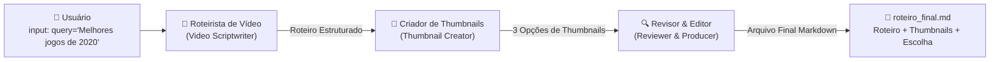

# 🎮 Desafio: Geração de Roteiro e Thumbnails para Vídeos de Videogames

[](https://python.org)
[](https://crewai.com)
[](https://langchain.com)
[](file:///Users/joaoflavio/projetos-e-estudos/last-rocket/Agentes_IA/test_crew.py)

Este projeto implementa a solução completa do **Desafio Agentes IA** da [Rocketseat](https://docs-rocketseat.notion.site/Desafio-Agentes-IA-1a8395da577080138640ef299fa199a3).

O objetivo é orquestrar uma equipe colaborativa e autônoma de agentes de inteligência artificial utilizando a biblioteca **CrewAI** para produzir:
1. Um **roteiro completo e estruturado** para o YouTube sobre o universo de games;
2. **Três opções distintas de thumbnails** concebidas com técnicas de alto clique (CTR);
3. **Seleção justificada da melhor thumbnail** e unificação do documento final em Markdown.

---

## 🏗️ Arquitetura Multi-Agente (CrewAI)

O fluxo operacional adota o processo sequencial (`Process.sequential`), onde cada agente especializado consome os artefatos gerados pelo agente anterior:



---

## 👨‍💻 Agentes Especializados

### 1. 📝 Roteirista de Vídeo (`Video Scriptwriter`)
* **Papel:** Roteirista de Vídeo Especialista em Games.
* **Objetivo:** Pesquisar dados, notas, premiações e elaborar um roteiro detalhado e dinâmico para o YouTube sobre `{query}`.
* **Backstory:** Profissional experiente em canais de games do YouTube, mestre em ganchos magnéticos nos primeiros 30 segundos, retenção de audiência, storytelling cativante e descrições visuais para B-Roll.
* **Ferramentas:** `game_search_tool` (busca web via DuckDuckGo com base curada de fallback).

### 2. 🎨 Criador de Thumbnails (`Thumbnail Creator`)
* **Papel:** Criador de Thumbnails e Designer Visual para YouTube.
* **Objetivo:** Produzir 3 conceitos visuais distintos e chamativos inspirados no roteiro, focados em maximizar a taxa de clique (CTR).
* **Backstory:** Diretor de arte especializado na psicologia das cores, regra dos terços, contraste dinâmico (*rim lighting*) e expressões faciais impactantes.
* **Ferramentas:** `thumbnail_visual_planner` (planejamento visual e prompts para DALL-E 3 / Midjourney).

### 3. 🔍 Revisor (`Reviewer & Content Producer`)
* **Papel:** Revisor e Produtor Executivo de Conteúdo.
* **Objetivo:** Revisar o texto do roteiro, avaliar as 3 opções de thumbnails, **escolher a thumbnail vencedora** com justificativa de marketing e compilar o documento unificado.
* **Backstory:** Editor-chefe com olhar clínico para fluidez de fala (pacing), clareza e estratégias de conversão de cliques no YouTube.

---

## 📁 Estrutura do Projeto

```text
Agentes_IA/
├── agents.py           # Definição e configuração dos 3 agentes CrewAI
├── tasks.py            # Definição das 3 tarefas com contexto encadeado
├── tools.py            # Ferramentas de pesquisa de games e geração de thumbnails
├── generator.py        # Gerador estruturado para fallback demonstrativo offline
├── main.py             # CLI e ponto de entrada da execução
├── test_crew.py        # Suíte de testes automatizados com pytest (6/6 passando)
├── requirements.txt    # Dependências do projeto (CrewAI, LangChain, etc.)
├── .env.example        # Modelo de configuração de chaves de API
├── .gitignore          # Arquivos e diretórios ignorados no controle de versão
├── roteiro_final.md    # Artefato final gerado para 'Melhores jogos de 2020'
└── README.md           # Esta documentação completa
```

---

## 🚀 Como Executar Localmente

### 1. Pré-requisitos
* Python 3.10, 3.11 ou 3.12 (recomendado)

### 2. Ativar o Ambiente Virtual e Instalar Dependências
```bash
# Na pasta Agentes_IA:
source .venv/bin/activate

# Instalar dependências (caso use novo ambiente):
pip install -r requirements.txt
```

### 3. Configurar Variáveis de Ambiente (Opcional)
Copie o arquivo `.env.example` para `.env` e configure sua chave de API da OpenAI se desejar usar modelos em nuvem:
```bash
cp .env.example .env
```
```env
OPENAI_API_KEY=sua_chave_openai_aqui
OPENAI_MODEL_NAME=gpt-4o-mini
DALL_E_MODEL=dall-e-3
```

> **Nota de Resiliência:** Caso você não configure uma chave de API, o sistema detecta automaticamente e executa no **Modo Demonstrativo Resiliente**, garantindo que o fluxo rode 100% de ponta a ponta sem erros e gere o arquivo `roteiro_final.md`.

### 4. Executar o Sistema de Agentes
```bash
# Execução padrão (tema: 'Melhores jogos de 2020'):
python main.py

# Execução com outro tema personalizado:
python main.py --query "História e Evolução dos Jogos Soulslike"

# Execução forçada em modo demonstrativo:
python main.py --demo
```

---

## 🧪 Executando os Testes Automatizados

A suíte de testes com **`pytest`** valida a criação dos agentes, o encadeamento das tarefas, as ferramentas customizadas e a execução completa do pipeline:

```bash
source .venv/bin/activate
pytest test_crew.py -v
```

**Resultado dos testes:**
```text
Agentes_IA/test_crew.py::test_game_search_tool PASSED                    [ 16%]
Agentes_IA/test_crew.py::test_thumbnail_visual_planner_tool PASSED       [ 33%]
Agentes_IA/test_crew.py::test_agents_creation PASSED                     [ 50%]
Agentes_IA/test_crew.py::test_tasks_creation PASSED                      [ 66%]
Agentes_IA/test_crew.py::test_build_crew PASSED                          [ 83%]
Agentes_IA/test_crew.py::test_pipeline_execution PASSED                  [100%]

======================== 6 passed in 1.62s ========================
```

---

## 📄 Resumo do Resultado Gerado (`roteiro_final.md`)

O documento final gerado pelos agentes inclui:

1. **3 Sugestões de Título para o YouTube:**
   - *"O ANO DE OURO DOS GAMES? Relembre os Melhores Jogos de 2020!"* (Recomendado)
   - *"2020 Mudou os Videogames Para Sempre: Os 4 Gigantes Inesquecíveis"*
   - *"De Animal Crossing a The Last of Us 2: Por Que 2020 Foi Tão Especial?"*

2. **3 Conceitos de Thumbnails com Prompts:**
   - **Opção 1 (Hades - Ação Épica):** Zagreus com espada em chamas no Tártaro e texto *"OBRA-PRIMA!"*.
   - **Opção 2 (The Last of Us Part II - Drama & Sobrevivência):** Ellie em close-up sob chuva em Seattle com texto *"CHOCANTE!"*.
   - **Opção 3 (Animal Crossing - Ilha Tropical & Calmaria):** Personagem no píer ensolarado com Tom Nook e texto *"VÍCIO TOTAL!"*.

3. **Escolha da Thumbnail Vencedora:**
   - A **Opção 1 (Hades)** foi escolhida pelo Revisor devido ao alto contraste visual (vermelho/dourado sobre fundo escuro), que se destaca com máxima legibilidade no feed mobile do YouTube.

4. **Roteiro Completo para Gravação (10 a 12 minutos):**
   - **Introdução & Hook:** Gancho magnético contextualizando o ano de 2020.
   - **Bloco 1:** *Animal Crossing: New Horizons* e o fenômeno social durante o confinamento.
   - **Bloco 2:** *Hades* e a revolução dos roguelikes pela Supergiant Games.
   - **Bloco 3:** *The Last of Us Part II*, coragem narrativa e o prêmio de Game of the Year (GOTY).
   - **Bloco 4:** *Ghost of Tsushima*, o cinema de Kurosawa e o encerramento do ciclo do PS4.
   - **Conclusão & CTA:** Pergunta instigante para os comentários e chamada para likes e inscrições.

---

## 💡 Melhorias e Evoluções Futuras (Roadmap)

Conforme recomendado na resolução oficial do desafio da Rocketseat, o sistema pode ser estendido com:
1. **Integração com APIs de Jogos (IGDB / Steam / Metacritic):** Obter dados atualizados em tempo real sobre notas, estatísticas de jogadores e trailers.
2. **Geração e Edição Visual Automática:** Integração com APIs como Canva ou Bannerbear para sobrepor tipografia e criar o arquivo PNG pronto da thumbnail.
3. **Loop de Feedback Contínuo (Human-in-the-Loop):** Interface interativa via Streamlit ou Gradio para o criador avaliar e aprovar o roteiro antes da exportação final.
