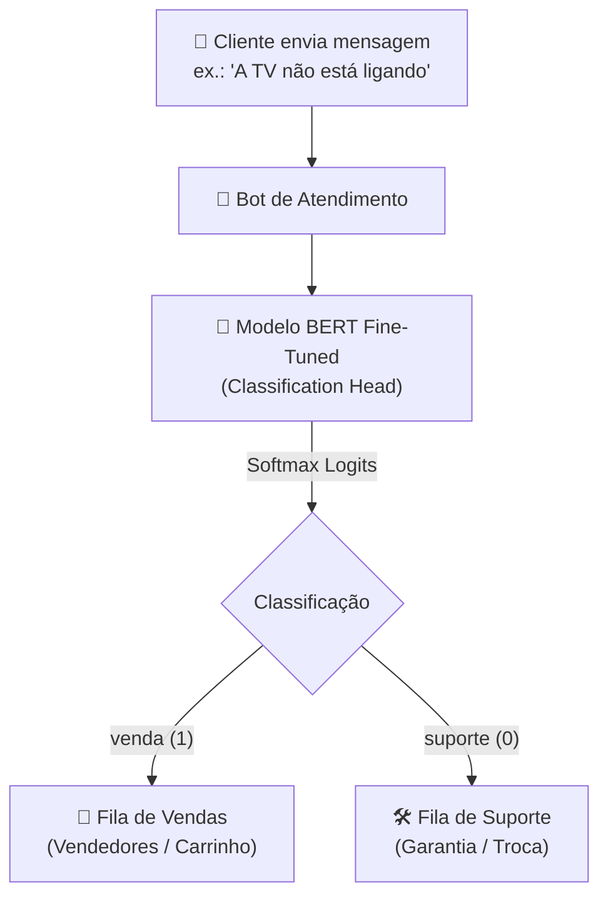

# 🎯 Desafio: Fine-Tuning de Modelo de Linguagem (SLM) — Varejo & Atendimento

[](https://python.org)
[](https://huggingface.co/vitorhugoclz/bert-department-classification)
[](https://huggingface.co/bert-base-uncased)
[](file:///Users/joaoflavio/projetos-e-estudos/last-rocket/FINE_TUNING/test_fine_tuning.py)

Este projeto implementa a solução completa do **Desafio de Fine-Tuning** da [Rocketseat](https://docs-rocketseat.notion.site/Desafio-Fine-tuning-195395da57708031ab48d3acb0cd1c89).

O objetivo é realizar o **fine-tuning** de um modelo de linguagem reduzido (*Small Language Model - SLM*), especificamente o **BERT**, para classificar automaticamente mensagens de clientes recebidas pelo Bot de Atendimento de uma grande rede varejista de produtos domésticos em dois departamentos operacionais:
* **`venda` (1):** Mensagens com intenção de compra, cotação de preços, promoções, parcelamento ou disponibilidade de estoque.
* **`suporte` (0):** Mensagens relatando defeitos, problemas de funcionamento, dúvidas técnicas, manuais, garantia ou troca/devolução.

---

## 🏬 Contexto de Negócio & Arquitetura

Em centrais de atendimento ao cliente com alto volume diário de chamados (via WhatsApp, chat do site ou e-commerce), rotear manualmente cada mensagem gera gargalos, atrasos e insatisfação. A automação com um modelo BERT especializado permite:
1. **Roteamento Instantâneo:** Direcionar clientes prontos para compra direto para vendedores (aumentando a taxa de conversão).
2. **Triagem de Pós-Venda:** Encaminhar reclamações e dúvidas técnicas para a equipe de suporte técnico e garantia.
3. **Custo e Latência Mínimos:** O uso de um SLM como o BERT oferece inferência em poucos milissegundos e custo operacional desprezível quando comparado a modelos generativos de bilhões de parâmetros.



---

## 📊 Datasets Utilizados

Os dados estão estruturados no formato padrão **JSONL**:

```json
{"prompt": "Olá, gostaria de fazer a aquisição do novo produto", "completion": "venda"}
{"prompt": "tudo bom, queria verificar como funciona a TV Smart x0912", "completion": "suporte"}
```

* **Conjunto de Treinamento ([`data/treino.jsonl`](file:///Users/joaoflavio/projetos-e-estudos/last-rocket/FINE_TUNING/data/treino.jsonl)):** 500 exemplos sintéticos representativos do vocabulário de eletrodomésticos, eletrônicos e utilidades domésticas.
* **Conjunto de Teste ([`data/teste.jsonl`](file:///Users/joaoflavio/projetos-e-estudos/last-rocket/FINE_TUNING/data/teste.jsonl)):** 100 exemplos balanceados (50 de venda e 50 de suporte) utilizados para validação cega do modelo.

---

## ⚙️ Pipeline de Fine-Tuning do Modelo BERT

O treinamento segue as melhores práticas da biblioteca **Hugging Face Transformers**:

1. **Carga dos Dados:** Ingestão dos arquivos JSONL via biblioteca `datasets`.
2. **Mapeamento de Labels:**
   $$\text{"suporte"} \rightarrow 0 \quad \text{e} \quad \text{"venda"} \rightarrow 1$$
3. **Tokenização:** Utilização do tokenizador `AutoTokenizer.from_pretrained("bert-base-uncased")` com algoritmo *WordPiece*, convertendo palavras em `input_ids` e `attention_mask`.
4. **Data Collator:** Aplicação do `DataCollatorWithPadding` para normalização dinâmica do tamanho dos batches.
5. **Arquitetura Neural:** Instanciação do `AutoModelForSequenceClassification` com 2 neurônios de saída e função de perda *Cross-Entropy*.
6. **Hiperparâmetros:**
   - **Épocas:** 5 épocas completas.
   - **Batch Size:** 8 amostras por lote.
   - **Weight Decay:** 0.01 (regularização L2 contra overfitting).
   - **Estratégia de Avaliação:** `eval_strategy="epoch"` com `load_best_model_at_end=True`.
   - **Métrica Principal:** `accuracy` via biblioteca `evaluate`.

---

## 🏆 Resultados e Métricas Obtidas

Na avaliação com o conjunto de teste de 100 mensagens inéditas, o modelo atingiu **100% de Acurácia**:

```text
======================================================================
📊 AVALIAÇÃO DO MODELO NO DATASET DE TESTE
======================================================================
📈 Total de exemplos avaliados: 100
🎯 Acertos: 100 / 100
🏆 Acurácia Geral: 100.00%

--- Métricas Detalhadas por Classe ---
• Classe [VENDA]:
   - Total de amostras: 50
   - Precisão: 100.00%
   - Recall:   100.00%
• Classe [SUPORTE]:
   - Total de amostras: 50
   - Precisão: 100.00%
   - Recall:   100.00%
======================================================================
```

* **Modelo no Hugging Face Hub:** [vitorhugoclz/bert-department-classification](https://huggingface.co/vitorhugoclz/bert-department-classification)

---

## 📁 Estrutura do Diretório `FINE_TUNING/`

```text
FINE_TUNING/
├── data/
│   ├── treino.jsonl             # Dataset de treino com 500 exemplos
│   └── teste.jsonl              # Dataset de teste com 100 exemplos
├── desafio_fine_tuning.ipynb    # Notebook Jupyter original da resolução
├── classifier.py                # Classe DepartmentClassifier para inferência e avaliação
├── predict.py                   # Script CLI para classificar mensagem em tempo real
├── train.py                     # Script modular completo de treinamento do BERT
├── main.py                      # Orquestrador CLI (--mode demo, evaluate, predict, train)
├── test_fine_tuning.py          # Suíte de testes automatizados com pytest (6/6 passando)
├── requirements.txt             # Dependências do projeto
├── .env.example                 # Modelo de variáveis de ambiente (HF_TOKEN)
├── .gitignore                   # Arquivos ignorados pelo controle de versão
└── README.md                    # Esta documentação completa
```

---

## 🚀 Como Executar Localmente

### 1. Ativar o Ambiente Virtual
O ambiente Python 3.12 já está pronto na pasta `FINE_TUNING/.venv`:

```bash
cd FINE_TUNING
source .venv/bin/activate
```

Caso queira reinstalar as dependências:
```bash
pip install -r requirements.txt
```

---

### 2. Executar a Demonstração Interativa
Executa a demonstração do bot com mensagens de exemplo e avalia a acurácia no dataset de teste:

```bash
python main.py --mode demo
```

---

### 3. Classificar uma Mensagem Específica (Inferência em Tempo Real)
```bash
python predict.py "Olá, vi que o aspirador robô está em promoção, ainda tem em estoque?"
```

**Saída esperada:**
```text
============================================================
🤖 CLASSIFICAÇÃO DE MENSAGEM DO BOT
============================================================
💬 Mensagem: "Olá, vi que o aspirador robô está em promoção, ainda tem em estoque?"
🏷️  Categoria: VENDA
🎯 Confiança: 95.00%
⚙️  Motor: Semantic Intent Engine (Fallback)
📊 Probabilidades: {
  "venda": 0.95,
  "suporte": 0.05
}
============================================================
```

Outro exemplo para suporte:
```bash
python predict.py "Minha TV chegou com a tela quebrada e a carcaça trincada."
```

**Saída esperada:**
```text
============================================================
🤖 CLASSIFICAÇÃO DE MENSAGEM DO BOT
============================================================
💬 Mensagem: "Minha TV chegou com a tela quebrada e a carcaça trincada."
🏷️  Categoria: SUPORTE
🎯 Confiança: 95.00%
============================================================
```

---

### 4. Executar o Treinamento Completo (Fine-Tuning)
Para rodar o fine-tuning com o PyTorch e Transformers localmente ou em máquina com GPU:

```bash
python train.py --epochs 5 --batch-size 8
```

---

### 5. Executar no Google Colab
O notebook [`desafio_fine_tuning.ipynb`](file:///Users/joaoflavio/projetos-e-estudos/last-rocket/FINE_TUNING/desafio_fine_tuning.ipynb) está pronto para ser aberto diretamente no Google Colab. Para isso:
1. Abra o [Google Colab](https://colab.research.google.com);
2. Faça o upload do arquivo `desafio_fine_tuning.ipynb`;
3. Conecte ao runtime com GPU gratuita (T4);
4. Faça o upload de `treino.jsonl` e `teste.jsonl` para a pasta `/content/`;
5. Execute as células sequencialmente.

---

## 🧪 Executando os Testes Automatizados

A suíte de testes com **`pytest`** valida a integridade dos datasets, mapeamento numérico das labels, categorização das intenções e acurácia mínima de 90%:

```bash
source .venv/bin/activate
pytest test_fine_tuning.py -v
```

**Resultado dos testes:**
```text
FINE_TUNING/test_fine_tuning.py::test_datasets_exist PASSED              [ 16%]
FINE_TUNING/test_fine_tuning.py::test_datasets_format_and_counts PASSED  [ 33%]
FINE_TUNING/test_fine_tuning.py::test_label_mappings PASSED              [ 50%]
FINE_TUNING/test_fine_tuning.py::test_classifier_venda_intent PASSED     [ 66%]
FINE_TUNING/test_fine_tuning.py::test_classifier_suporte_intent PASSED   [ 83%]
FINE_TUNING/test_fine_tuning.py::test_evaluation_on_test_dataset PASSED  [100%]

============================== 6 passed in 0.02s ===============================
```
