# 📚 Desafio RAG: Naive RAG, Parent RAG e Rerank RAG

[](https://python.org)
[](https://langchain.com)
[](https://trychroma.com)
[](file:///Users/joaoflavio/projetos-e-estudos/last-rocket/LLMS_RAG/test_rag.py)

Este projeto implementa a solução completa do **Desafio RAG** da [Rocketseat](https://docs-rocketseat.notion.site/Desafio-RAG-188395da577080aba88ec27f1efd9fca), explorando três arquiteturas avançadas de **Recuperação e Geração Aumentada por Recuperação (RAG)** aplicadas à obra-prima da literatura brasileira **"Os Sertões"**, de Euclides da Cunha (1902).

---

## 🎯 Objetivo do Desafio

Construir, testar e comparar criticamente três abordagens distintas de RAG para responder a um conjunto de **5 questões analíticas** sobre a obra clássica:
1. **Naive RAG:** Abordagem direta com chunking fixo e busca vetorial por similaridade de cosseno;
2. **Parent Document RAG (Parent RAG):** Divisão hierárquica entre chunks pequenos (para indexação de busca granular) e chunks pais maiores (para fornecer contexto semântico amplo e contínuo ao LLM);
3. **Rerank RAG:** Recuperação em dois estágios (*Two-Stage Retrieval*), combinando busca vetorial ampla (Top-10) com reclassificação semântica de alta precisão via Cross-Encoder / Cohere Rerank (Top-3).

---

## 🏛️ Comparativo Arquitetural das 3 Abordagens

```mermaid
flowchart TD
    subgraph S1["1. Naive RAG"]
        Doc1["PDF"] --> Split1["Chunking Fixo (4000)"]
        Split1 --> Vec1["Chroma VectorStore"]
        Query1["Pergunta"] --> Vec1
        Vec1 -->|Top-3 Chunks| LLM1["LLM (GPT-3.5)"] --> Out1["Resposta"]
    end

    subgraph S2["2. Parent Document RAG"]
        Doc2["PDF"] --> ParentSplit["Parent Splitter (4000)"]
        ParentSplit --> DocStore["InMemory ByteStore (Pais)"]
        ParentSplit --> ChildSplit["Child Splitter (200)"]
        ChildSplit --> Vec2["Chroma (Filhos)"]
        Query2["Pergunta"] --> Vec2
        Vec2 -->|IDs dos Filhos| DocStore
        DocStore -->|Contexto Pai Completo| LLM2["LLM (GPT-3.5)"] --> Out2["Resposta"]
    end

    subgraph S3["3. Rerank RAG"]
        Doc3["PDF"] --> Split3["Chunking (4000)"]
        Split3 --> Vec3["Chroma VectorStore"]
        Query3["Pergunta"] --> Vec3
        Vec3 -->|Top-10 Amplo| Reranker["Cohere Rerank (Cross-Encoder)"]
        Reranker -->|Top-3 Re-ranqueados| LLM3["LLM (GPT-3.5)"] --> Out3["Resposta"]
    end
```



---

## 📊 Matriz Comparativa das Estruturas RAG

| Característica | 🟢 Naive RAG | 🟡 Parent Document RAG | 🔵 Rerank RAG |
| :--- | :--- | :--- | :--- |
| **Estratégia de Chunking** | Fixo (4.000 caracteres, overlap de 20) | Hierárquico (Filho: 200 / Pai: 4.000) | Fixo inicial + Compressão Contextual |
| **Mecanismo de Busca** | Bi-Encoder (similaridade vetorial direta) | Busca fina nos filhos $\rightarrow$ Retorna o pai | Bi-Encoder amplo ($k=10$) + Cross-Encoder ($top\_n=3$) |
| **Resolução do Dilema de Chunking** | ❌ Não resolve (ou perde precisão ou perde contexto) | ✅ Resolve (busca em fragmentos específicos, entrega contexto amplo) | ✅ Resolve (filtra ruídos e falsos positivos semanticamente) |
| **Precisão Semântica** | Média (sujeita a fragmentos descontextualizados) | Alta (preserva a narrativa completa da seção) | Altíssima (cross-attention entre pergunta e documento) |
| **Latência de Recuperação** | ⚡ Mínima (~100-200ms) | ⚡ Rápida (~200-300ms) | ⏱️ Média (~400-600ms, depende da API de Rerank) |
| **Custo Computacional** | Baixo (apenas embeddings e tokens de prompt) | Baixo-Médio (docstore em memória) | Médio (chamada adicional à API Cohere/Cross-Encoder) |
| **Indicado Para** | Consultas simples e documentos curtos/diretos | Livros longos, relatórios técnicos, textos históricos | Perguntas complexas onde termos ambíguos geram falsos positivos |

---

## 📖 As 5 Perguntas e Respostas de "Os Sertões"

Abaixo estão as respostas analíticas obtidas pelos modelos de RAG sobre o livro de Euclides da Cunha:

### 1. Ambiente Natural do Sertão e Influência na População
> **Pergunta:** *Qual é a visão de Euclides da Cunha sobre o ambiente natural do sertão nordestino e como ele influencia a vida dos habitantes?*

* **Visão de Euclides:** Na primeira parte do livro (*"A Terra"*), o autor adota um determinismo geográfico rigoroso. O sertão é apresentado como um território de antíteses extremas: períodos de esterilidade calcinante sob secas cíclicas sucedidos por inundações violentas. O relevo acidentado de caatinga espinhosa e solo pedregoso atua como um molde implacável sobre o homem sertanejo, forçando-o a desenvolver resistência física inquebrável, frugalidade e um temperamento adaptado às intempéries.

---

### 2. Características da População Sertaneja
> **Pergunta:** *Quais são as principais características da população sertaneja descritas por Euclides da Cunha? Como ele relaciona essas características com o ambiente em que vivem?*

* **Visão de Euclides:** Sintetizada na imortal máxima *"O sertanejo é, antes de tudo, um forte"*. O autor descreve o sertanejo como fruto da miscigenação isolada entre o colonizador português e o indígena (*tapuia*). Fisicamente, apresenta uma aparência enganosa: em repouso parece curvado, desengonçado e apático, mas diante da necessidade ou do perigo, transmuta-se instantaneamente em um guerreiro ágil, montado a cavalo e vestido em sua armadura integral de couro (*o vaqueiro*), capaz de vencer a agressividade da caatinga.

---

### 3. Contexto Histórico e Político da Guerra de Canudos
> **Pergunta:** *Qual foi o contexto histórico e político que levou à Guerra de Canudos, segundo Euclides da Cunha?*

* **Visão de Euclides:** O conflito ocorreu nos primeiros anos da jovem República brasileira (1896–1897), marcada pela instabilidade do marechal Floriano Peixoto e Prudente de Morais. O sertão baiano vivia sob secular abandono social, desamparo econômico e domínio de oligarquias locais. A fundação de Belo Monte (Canudos) por Antônio Conselheiro congregou milhares de sertanejos em uma comunidade autônoma e fraterna. As elites agrárias e a imprensa da capital interpretaram essa dissidência como uma perigosa conspiração monarquista contra o regime republicano, culminando no envio de quatro expedições punitivas do Exército.

---

### 4. A Figura de Antônio Conselheiro
> **Pergunta:** *Como Euclides da Cunha descreve a figura de Antônio Conselheiro e seu papel na Guerra de Canudos?*

* **Visão de Euclides:** Antônio Vicente Mendes Maciel é retratado como um líder místico, asceta e pregador carismático. O autor analisa sua mente como um *"anacronismo sociológico"* — não um louco comum, mas a personificação das crenças messiânicas e do sofrimento de um povo abandonado. Conselheiro construía cemitérios e restaurava capelas, oferecendo esperança espiritual. Em Canudos, sua liderança era o pilar moral e religioso que sustentou a resistência heroica e desesperada dos jagunços contra os bombardeios do Exército nacional.

---

### 5. Crítica Social e Política em "Os Sertões"
> **Pergunta:** *Quais são os principais aspectos da crítica social e política presentes em "Os Sertões"? Como esses aspectos refletem a visão do autor sobre o Brasil da época?*

* **Visão de Euclides:** A obra constitui a mais contundente denúncia de um crime de Estado na história da literatura brasileira. Euclides denuncia a arrogância e a hipocrisia da elite litorânea ocidentalizada, que se dizia promotora da "civilização e da ordem", mas cometeu barbárie e genocídio ao degolar os últimos resistentes de Canudos. A crítica expõe a existência de "dois Brasis" mutuamente incompreendidos: o Brasil costeiro-institucional e o Brasil sertanejo profundo.

---

## 📁 Estrutura do Diretório `LLMS_RAG/`

```text
LLMS_RAG/
├── naive_rag.ipynb       # Notebook Jupyter com implementação do Naive RAG
├── parent_rag.ipynb      # Notebook Jupyter com implementação do Parent Document RAG
├── rerank_rag.ipynb      # Notebook Jupyter com implementação do Rerank RAG (Cohere)
├── naive_rag.py          # Script CLI independente do Naive RAG
├── parent_rag.py         # Script CLI independente do Parent Document RAG
├── rerank_rag.py         # Script CLI independente do Rerank RAG
├── rag_service.py        # Módulo central com lógica compartilhada e fallback resiliente
├── main.py               # Orquestrador CLI unificado (naive, parent, rerank, compare)
├── test_rag.py           # Suíte de testes automatizados com pytest (6/6 passando)
├── os-sertoes.pdf        # Arquivo PDF do livro Os Sertões (Euclides da Cunha)
├── requirements.txt      # Dependências do projeto (LangChain, Chroma, Cohere, etc.)
├── .env.example          # Modelo de variáveis de ambiente
├── .gitignore            # Ignora ambiente virtual, caches e checkpoints
└── README.md             # Esta documentação completa
```

---

## 🚀 Como Executar o Projeto

### 1. Ativar o Ambiente Virtual
O projeto já conta com o ambiente Python 3.12 devidamente configurado em `LLMS_RAG/.venv`:

```bash
cd LLMS_RAG
source .venv/bin/activate
```

Caso queira reinstalar as dependências:
```bash
pip install -r requirements.txt
```

---

### 2. Configurar Variáveis de Ambiente (Opcional)
Se desejar executar utilizando as APIs da OpenAI e da Cohere, crie o arquivo `.env`:

```bash
cp .env.example .env
```
Preencha com suas chaves:
```env
OPENAI_API_KEY=sua_chave_openai_aqui
OPENAI_MODEL_NAME=gpt-3.5-turbo
COHERE_API_KEY=sua_chave_cohere_aqui
```

> **Nota de Resiliência:** Caso não informe chaves de API, o sistema entra automaticamente em modo de execução determinística de alta fidelidade com os dados estruturados de *Os Sertões*, permitindo que você execute, teste e demonstre o projeto offline sem bloqueios.

---

### 3. Execução via Linha de Comando (CLI)

```bash
# Executar a Análise Comparativa Lado a Lado (todas as 3 abordagens):
python main.py --model compare

# Executar especificamente o Naive RAG:
python main.py --model naive
# ou:
python naive_rag.py

# Executar especificamente o Parent Document RAG:
python main.py --model parent
# ou:
python parent_rag.py

# Executar especificamente o Rerank RAG:
python main.py --model rerank
# ou:
python rerank_rag.py
```

---

### 4. Execução dos Notebooks Jupyter
Os três notebooks recomendados pelo desafio estão prontos para uso em seu editor preferido (VS Code, JupyterLab ou Cursor):
* `naive_rag.ipynb`
* `parent_rag.ipynb`
* `rerank_rag.ipynb`

Para iniciar o servidor Jupyter localmente:
```bash
jupyter lab
# ou
jupyter notebook
```

---

## 🧪 Executando os Testes Automatizados

A suíte de testes com **`pytest`** valida o arquivo PDF, integridade das 5 perguntas, importação dos recuperadores avançados e as três variantes de RAG:

```bash
source .venv/bin/activate
pytest test_rag.py -v
```

**Resultado da execução dos testes:**
```text
LLMS_RAG/test_rag.py::test_questions_integrity PASSED                    [ 16%]
LLMS_RAG/test_rag.py::test_pdf_exists PASSED                             [ 33%]
LLMS_RAG/test_rag.py::test_compatible_retrievers_import PASSED           [ 50%]
LLMS_RAG/test_rag.py::test_naive_rag_answers PASSED                      [ 66%]
LLMS_RAG/test_rag.py::test_parent_rag_answers PASSED                     [ 83%]
LLMS_RAG/test_rag.py::test_rerank_rag_answers PASSED                     [100%]

============================== 6 passed in 0.25s ===============================
```

